# Architecture du code

Deux graphes Mermaid, **générés depuis le code** par `npm run generate:architecture` et versionnés ici. Le test [`scripts/architecture/architecture.test.ts`](../../scripts/architecture/architecture.test.ts) les régénère et les compare aux fichiers versionnés, à chaque `npm run check` : hook pre-push, hook Stop de Claude Code et job `check` de la CI.

| Fichier | Ce qu'il montre | Ce qui fait échouer le test |
|---|---|---|
| [`layers.mmd`](layers.mmd) | Les couches de l'[ADR-002](../adr/ADR-002-architecture-cible.md) (§3.3) et qui importe qui, d'après le code de production de `src/` (tests exclus) | le graphe a dérivé du code ; une flèche que la matrice interdit, dont tout paquet importé par le cœur sans droit (module de Node compris) ; un fichier hors des couches ; un import au chemin calculé ; une exception legacy qui ne sert plus |
| [`routes.mmd`](routes.mmd) | Chaque méthode de `src/app/**/route.ts` et la garde qui la protège | le graphe a dérivé du code ; une méthode sans garde qui ouvre le handler (`CLAUDE.md`, règle 2) ; une route publique déclarée qui n'existe plus |

La matrice des couches, les exceptions legacy (`LEGACY_EDGES`) et les routes publiques (`PUBLIC_ROUTES`) sont déclarées dans [`scripts/architecture/layers.ts`](../../scripts/architecture/layers.ts).

## Doc des développeurs

Ces deux graphes et les vues écrites à la main de [`vues/`](vues/) (services, parcours, données, ADR…) illustrent la doc des développeurs, [`docs/index.html`](../index.html). `npm run generate:architecture` les recopie dans la page entre leurs marqueurs `<!-- début : … -->` et `<!-- fin : … -->`, échappés pour le HTML ; la page les dessine avec Mermaid. Une vue se modifie dans son `.mmd`, jamais dans la page.

Le même test échoue si la page a dérivé de ses schémas, si un schéma n'y a pas de marqueurs ou un marqueur plus de schéma, si une ADR n'a pas sa fiche (`id="adr-NNN"`), si [`vues/schema.mmd`](vues/schema.mmd) n'a pas exactement les tables des migrations, si un type d'événement de l'outbox n'est pas cité, ou si un script externe est chargé sans empreinte SRI. Le reste se tient à jour à la main, dans la même PR que le code : `CLAUDE.md`, « Documentation développeur ».

## Quand le test échoue

- **Le graphe a dérivé** : un import entre couches ou une route a changé. Lancer `npm run generate:architecture`, relire le diff du `.mmd` et le commiter avec le code. Dans la PR, ce diff montre l'évolution de l'architecture aux relecteurs.
- **Flèche interdite** : corriger l'import (passer par un cas d'usage, un port, la composition). Régénérer ne suffit pas : la flèche reste rouge et le test échoue toujours.
- **Route sans garde** : la garde ouvre le handler, avant tout autre code : `const session = await auth()`, `const actor = requireRole(session, 'rôle')`, puis `if (actor instanceof Response) return actor` (ou `if (!session?.user?.id) throw …`). Elle peut ouvrir un `try` dont le `catch` sort (return ou throw). `auth` et `requireRole` viennent de `@/lib/auth` et `@/http/requireRole`, et le handler est une fonction ou une `const`. Un wrapper déclaré dans `routes.ts` (`withApiErrors`) se traverse ; une garde placée plus loin, dans une branche, un helper ou un callback ne se voit pas.
- **Nouvelle couche, nouveau droit** : décision d'architecture, à justifier dans la PR (ADR-002), puis à déclarer dans `layers.ts`.
- **Exception legacy ou route publique en trop** : la retirer de `layers.ts`. Ces listes ne font que raccourcir, comme les listes `LEGACY_*` de `eslint.config.mjs`.

Le lint ([`eslint.config.mjs`](../../eslint.config.mjs)) donne l'erreur à la ligne près pour certaines de ces règles (domaine pur, pas de SQL ni d'accès base dans les routes). Ce graphe couvre la matrice entière, couche par couche, et la rend visible.

## Couches et imports

En bleu les entrées (routes, pages, worker), en vert le cœur (cas d'usage, domaine, ports), en jaune l'infrastructure, en gris les paquets npm. Flèche pleine : permise. Pointillés orange « legacy » : interdite mais encore présente, tolérée jusqu'à sa correction. Rouge « interdit » : fait échouer le test.

```mermaid
flowchart TB
  %% Généré par npm run generate:architecture (scripts/architecture) : ne pas modifier à la main.
  m_app["app (pages)"]
  m_app_2f_actions["app/actions"]
  m_app_2f_api["app/api"]
  m_app_2f_verify_2d_email["app/verify-email"]
  m_components["components"]
  m_http["http"]
  m_instrumentation["instrumentation"]
  m_proxy["proxy"]
  m_types["types"]
  m_worker["worker"]
  m_application["application"]
  m_domain["domain"]
  m_generated["generated"]
  m_ports["ports"]
  m_utils["utils"]
  m_adapters["adapters"]
  m_composition["composition"]
  m_lib_2f_auth["lib/auth"]
  m_lib_2f_authErrors["lib/authErrors"]
  m_lib_2f_authSecret["lib/authSecret"]
  m_lib_2f_db["lib/db"]
  m_lib_2f_dbRole["lib/dbRole"]
  m_lib_2f_email["lib/email"]
  m_lib_2f_errors["lib/errors"]
  m_lib_2f_log["lib/log"]
  m_lib_2f_loginThrottle["lib/loginThrottle"]
  m_lib_2f_outbox["lib/outbox"]
  m_lib_2f_sessionUser["lib/sessionUser"]
  m_lib_2f_storage["lib/storage"]
  m_lib_2f_tokens["lib/tokens"]
  p__40_aws_2d_sdk(["@aws-sdk"])
  p_next(["next"])
  p_next_2d_auth(["next-auth"])
  p_node_3a_crypto(["node:crypto"])
  p_nodemailer(["nodemailer"])
  p_pg(["pg"])
  p_react(["react"])
  p_sharp(["sharp"])
  m_adapters --> p_nodemailer
  m_adapters --> p_pg
  m_adapters --> p_sharp
  m_adapters --> m_domain
  m_adapters --> m_lib_2f_db
  m_adapters --> m_lib_2f_storage
  m_adapters --> m_ports
  m_app --> p_next
  m_app --> p_react
  m_app --> m_app_2f_actions
  m_app --> m_components
  m_app --> m_composition
  m_app --> m_http
  m_app --> m_lib_2f_auth
  m_app_2f_actions --> p_next
  m_app_2f_actions --> p_next_2d_auth
  m_app_2f_actions --> m_application
  m_app_2f_actions --> m_composition
  m_app_2f_actions --> m_lib_2f_auth
  m_app_2f_actions --> m_lib_2f_authErrors
  m_app_2f_api --> p_next
  m_app_2f_api --> m_application
  m_app_2f_api --> m_composition
  m_app_2f_api --> m_domain
  m_app_2f_api --> m_http
  m_app_2f_api --> m_lib_2f_auth
  m_app_2f_verify_2d_email --> p_next
  m_app_2f_verify_2d_email --> m_composition
  m_application --> p_node_3a_crypto
  m_application --> m_domain
  m_application --> m_ports
  m_components --> p_next
  m_components --> p_react
  m_components --> m_app_2f_actions
  m_components --> m_http
  m_components --> m_types
  m_composition --> m_adapters
  m_composition --> m_application
  m_composition --> m_lib_2f_tokens
  m_composition --> m_ports
  m_domain --> m_generated
  m_domain --> m_ports
  m_http --> p_next_2d_auth
  m_http --> m_composition
  m_http --> m_domain
  m_http --> m_generated
  m_http --> m_lib_2f_auth
  m_http --> m_lib_2f_log
  m_http --> m_ports
  m_http --> m_types
  m_instrumentation --> p_next
  m_instrumentation --> m_lib_2f_authSecret
  m_instrumentation --> m_lib_2f_dbRole
  m_instrumentation --> m_lib_2f_log
  m_lib_2f_auth --> p_next
  m_lib_2f_auth --> p_next_2d_auth
  m_lib_2f_auth --> m_lib_2f_authErrors
  m_lib_2f_auth --> m_lib_2f_db
  m_lib_2f_auth --> m_lib_2f_log
  m_lib_2f_auth --> m_lib_2f_loginThrottle
  m_lib_2f_auth --> m_lib_2f_sessionUser
  m_lib_2f_authErrors --> p_next_2d_auth
  m_lib_2f_authSecret --> m_lib_2f_log
  m_lib_2f_db --> p_pg
  m_lib_2f_dbRole --> m_lib_2f_db
  m_lib_2f_dbRole --> m_lib_2f_log
  m_lib_2f_email --> m_adapters
  m_lib_2f_email --> m_ports
  m_lib_2f_errors --> m_http
  m_lib_2f_loginThrottle --> m_lib_2f_db
  m_lib_2f_outbox --> p_pg
  m_lib_2f_outbox --> m_lib_2f_db
  m_lib_2f_outbox --> m_ports
  m_lib_2f_sessionUser --> p_react
  m_lib_2f_sessionUser --> m_domain
  m_lib_2f_sessionUser --> m_lib_2f_db
  m_lib_2f_storage --> p__40_aws_2d_sdk
  m_lib_2f_storage --> m_domain
  m_ports --> m_domain
  m_proxy --> p_next
  m_proxy --> m_lib_2f_auth
  m_types --> p_next_2d_auth
  m_worker --> p_pg
  m_worker --> m_adapters
  m_worker --> m_application
  m_worker --> m_composition
  m_worker --> m_domain
  m_worker --> m_lib_2f_db
  m_worker --> m_lib_2f_dbRole
  m_worker --> m_lib_2f_email
  m_worker --> m_lib_2f_log
  m_worker --> m_lib_2f_outbox
  m_worker --> m_lib_2f_tokens
  m_worker --> m_ports
  classDef entrees fill:#dbeafe,stroke:#2563eb,color:#111827
  class m_app,m_app_2f_actions,m_app_2f_api,m_app_2f_verify_2d_email,m_components,m_http,m_instrumentation,m_proxy,m_types,m_worker entrees
  classDef coeur fill:#dcfce7,stroke:#16a34a,color:#111827
  class m_application,m_domain,m_generated,m_ports,m_utils coeur
  classDef infra fill:#fef9c3,stroke:#a16207,color:#111827
  class m_adapters,m_composition,m_lib_2f_auth,m_lib_2f_authErrors,m_lib_2f_authSecret,m_lib_2f_db,m_lib_2f_dbRole,m_lib_2f_email,m_lib_2f_errors,m_lib_2f_log,m_lib_2f_loginThrottle,m_lib_2f_outbox,m_lib_2f_sessionUser,m_lib_2f_storage,m_lib_2f_tokens infra
  classDef paquet fill:#f3f4f6,stroke:#6b7280,color:#111827
  class p__40_aws_2d_sdk,p_next,p_next_2d_auth,p_node_3a_crypto,p_nodemailer,p_pg,p_react,p_sharp paquet
```

<!-- début : layers.mmd -->

<!-- fin : layers.mmd -->

## Routes et rôles

Une garde par nœud à gauche, une méthode de route par nœud à droite. « Session requise » : `requireRole(session)` ou une session vérifiée, quel que soit le rôle. Une méthode sans garde est rouge.

```mermaid
flowchart LR
  %% Généré par npm run generate:architecture (scripts/architecture) : ne pas modifier à la main.
  g_public(["Publique (PUBLIC_ROUTES)"])
  g_session(["Session requise"])
  g_role_hr_5f_admin(["Rôle hr_admin"])
  g_role_manager(["Rôle manager"])
  r_GET_20__2f_api_2f_auth_2f__5b__2e__2e__2e_nextauth_5d_["GET /api/auth/[...nextauth]"]
  r_POST_20__2f_api_2f_auth_2f__5b__2e__2e__2e_nextauth_5d_["POST /api/auth/[...nextauth]"]
  r_GET_20__2f_api_2f_expense_2d_notes["GET /api/expense-notes"]
  r_POST_20__2f_api_2f_expense_2d_notes["POST /api/expense-notes"]
  r_GET_20__2f_api_2f_expense_2d_notes_2f__5b_id_5d__2f_receipt_2d_url["GET /api/expense-notes/[id]/receipt-url"]
  r_POST_20__2f_api_2f_expense_2d_notes_2f_receipt_2d_suggestion["POST /api/expense-notes/receipt-suggestion"]
  r_GET_20__2f_api_2f_hr_2f_expense_2d_notes["GET /api/hr/expense-notes"]
  r_POST_20__2f_api_2f_hr_2f_expense_2d_notes_2f__5b_id_5d__2f_approve["POST /api/hr/expense-notes/[id]/approve"]
  r_GET_20__2f_api_2f_hr_2f_expense_2d_notes_2f__5b_id_5d__2f_receipt_2d_url["GET /api/hr/expense-notes/[id]/receipt-url"]
  r_POST_20__2f_api_2f_hr_2f_expense_2d_notes_2f__5b_id_5d__2f_reject["POST /api/hr/expense-notes/[id]/reject"]
  r_POST_20__2f_api_2f_hr_2f_invitations["POST /api/hr/invitations"]
  r_GET_20__2f_api_2f_hr_2f_users["GET /api/hr/users"]
  r_PUT_20__2f_api_2f_hr_2f_users_2f__5b_id_5d__2f_manager["PUT /api/hr/users/[id]/manager"]
  r_GET_20__2f_api_2f_manager_2f_expense_2d_notes["GET /api/manager/expense-notes"]
  r_POST_20__2f_api_2f_manager_2f_expense_2d_notes_2f__5b_id_5d__2f_approve["POST /api/manager/expense-notes/[id]/approve"]
  r_GET_20__2f_api_2f_manager_2f_expense_2d_notes_2f__5b_id_5d__2f_receipt_2d_url["GET /api/manager/expense-notes/[id]/receipt-url"]
  r_POST_20__2f_api_2f_manager_2f_expense_2d_notes_2f__5b_id_5d__2f_reject["POST /api/manager/expense-notes/[id]/reject"]
  r_POST_20__2f_api_2f_receipt_2d_analyses["POST /api/receipt-analyses"]
  r_GET_20__2f_api_2f_receipt_2d_analyses_2f__5b_id_5d_["GET /api/receipt-analyses/[id]"]
  r_GET_20__2f_verify_2d_email["GET /verify-email"]
  g_public --> r_GET_20__2f_api_2f_auth_2f__5b__2e__2e__2e_nextauth_5d_
  g_public --> r_POST_20__2f_api_2f_auth_2f__5b__2e__2e__2e_nextauth_5d_
  g_session --> r_GET_20__2f_api_2f_expense_2d_notes
  g_session --> r_POST_20__2f_api_2f_expense_2d_notes
  g_session --> r_GET_20__2f_api_2f_expense_2d_notes_2f__5b_id_5d__2f_receipt_2d_url
  g_session --> r_POST_20__2f_api_2f_expense_2d_notes_2f_receipt_2d_suggestion
  g_role_hr_5f_admin --> r_GET_20__2f_api_2f_hr_2f_expense_2d_notes
  g_role_hr_5f_admin --> r_POST_20__2f_api_2f_hr_2f_expense_2d_notes_2f__5b_id_5d__2f_approve
  g_role_hr_5f_admin --> r_GET_20__2f_api_2f_hr_2f_expense_2d_notes_2f__5b_id_5d__2f_receipt_2d_url
  g_role_hr_5f_admin --> r_POST_20__2f_api_2f_hr_2f_expense_2d_notes_2f__5b_id_5d__2f_reject
  g_role_hr_5f_admin --> r_POST_20__2f_api_2f_hr_2f_invitations
  g_role_hr_5f_admin --> r_GET_20__2f_api_2f_hr_2f_users
  g_role_hr_5f_admin --> r_PUT_20__2f_api_2f_hr_2f_users_2f__5b_id_5d__2f_manager
  g_role_manager --> r_GET_20__2f_api_2f_manager_2f_expense_2d_notes
  g_role_manager --> r_POST_20__2f_api_2f_manager_2f_expense_2d_notes_2f__5b_id_5d__2f_approve
  g_role_manager --> r_GET_20__2f_api_2f_manager_2f_expense_2d_notes_2f__5b_id_5d__2f_receipt_2d_url
  g_role_manager --> r_POST_20__2f_api_2f_manager_2f_expense_2d_notes_2f__5b_id_5d__2f_reject
  g_session --> r_POST_20__2f_api_2f_receipt_2d_analyses
  g_session --> r_GET_20__2f_api_2f_receipt_2d_analyses_2f__5b_id_5d_
  g_public --> r_GET_20__2f_verify_2d_email
```

<!-- début : routes.mmd -->

<!-- fin : routes.mmd -->
