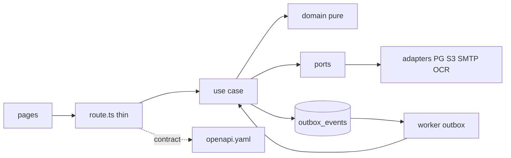

# Expense.io Consolidation Without Breaking Changes

*   **Author:** expense-io team
*   **Status:** Draft
*   **Date:** 2026-10-28

--------------------------------------------------------------------------------

## Overview

Expense.io is a B2B SaaS for expense notes. One tenant equals one company. Seven ADRs describe the target on `main` at `16556f5`: tenant isolation with Postgres RLS, modular hexagonal monolith, transactional outbox for async work, RFC 9457 contract-first API, CI plus E2E guards, migration strategy (ADR-006, Proposée), and OpenTelemetry observability.

The drift report of 2026-10-28 was computed on a stale branch and no longer applies. On current `main`, `LEGACY_DB_ACCESS`, `LEGACY_GET_POOL`, `LEGACY_SQL_INTERPOLATION`, and `LEGACY_EDGES` are empty, root `openapi.yaml` describes 17 operations, 11 migrations cover outbox, receipt analyses, decided-by/at, RLS, invitations, unverified-address resend, idempotency, receipt-key, roles, and login attempts across 7+ tables, and ADR-006 (Proposée) reports route migration done with green E2E and identical contract pending PO acceptance.

This design therefore locks the reached target and finishes consolidation in the same repo, with the E2E suite as the oracle for no regression and no breaking HTTP change.

## The Problem

Direct cleanup in place kept reintroducing the same failure class: a forgotten `WHERE` leaks one tenant into another, a second connection breaks submission atomicity, and error shape changes break the frontend and the graders replaying E2E. A new empty repo would lose migration history, ADR links, CI, and the E2E IDs that encode the contract, so it stays rejected per ADR-006 (Big Bang out).

What remains is consolidation, not a rebuild: keep HTTP behavior observed by E2E identical, keep the four `LEGACY_*` lists (`DB_ACCESS`, `GET_POOL`, `SQL_INTERPOLATION`, `EDGES`) empty, and close the last gaps (deprecated `error` removal date, `dead`-event count without index, second-adapter switch only when it ships).

## Goals

*   Goal 1: All Playwright E2E scenarios that pass today still pass without modification, with the same status codes, UI flows, and JSON fields. New response fields need their own test per ADR-005 §2, and enum additions are not auto-compatible per ADR-004 §7.1. Errors keep `application/problem+json` with stable `code` and `requestId` while keeping the deprecated `error` member with its historic text. Any E2E change needs an accepted ADR plus a separate test commit under CODEOWNERS review.
*   Goal 2: Tenant isolation stays held: RLS under `expense_app` keeps carrying the company boundary, manual `WHERE company_id` stays as defense in depth, and ISO-04 to ISO-09 stay green with fixtures under the owner role via `E2E_DATABASE_URL`.
*   Goal 3: Submission stays atomic and replay-safe: S3 upload first, then one SQL transaction for note plus outbox event, `Idempotency-Key` deduplication held, zero `receipt_key = ''` rows.
*   Goal 4: Async stays on one mechanism: Postgres `outbox_events` plus worker, bounded retries, dead-letter state, one event per recipient.
*   Goal 5: Contract stays explicit and checked: root `openapi.yaml` keeps describing 17 operations, errors keep `application/problem+json` with stable `code` and `requestId`, CI keeps failing on drift via `bash scripts/check-api-breaking.sh origin/main` and `npm run check:api`.
*   Goal 6: Schema stays additive and reversible: initial migration untouched, each new change as timestamped migration with `down`; the restricted-role connection already landed stays verified by the suite on every PR.

## Non-Goals

*   Non-Goal 1: No new product features. No billing implementation beyond a future `BillingPort` fed by `expense_note.decided` on approved only. No multi-currency, no in-app notification center.
*   Non-Goal 2: No micro-services, no new broker, no new database. One Next.js deployment plus Postgres plus S3 plus worker stays.
*   Non-Goal 3: No URL prefix versioning (`/v1`) and no pagination. Lists stay complete; cursor pagination reopens via new ADR only above a few hundred items per tenant or measurable list load. The deprecated `error` member stays until its announced removal.
*   Non-Goal 4: No multi-region replication. One instance (app plus base) per region holds under the single-region-attachment hypothesis. Cross-region approval reopens the design.

## Open Questions

*   **Question 1**: When is the deprecated `error` member removed after its announced release, and which consumers still read it?
*   **Question 2**: `dead`-event count stays without index per ADR-007 local-only debt. Sustained outbox lag over 1 min triggers broker reconsideration per ADR-003, not the index. What volume gate, if any, adds the index before that?
*   **Question 3**: Deferred, not this delivery: no switch until a second adapter ships in the same PR (ADR-006 decision 2). First candidate still undecided: OCR to external AI or billing on `expense_note.decided` approved.

## Technical Plan (Architecture)

Route handlers stay thin: authenticate, validate input against the contract, call one use case, format the response. Use cases orchestrate pure domain plus ports. Adapters implement ports for Postgres, S3, SMTP, and Tesseract. `src/composition/` wires ports to adapters and gains an environment selector only with a second adapter in the same PR. The worker consumes `outbox_events` through registered handlers (`buildHandlers()`, `PgEventOutbox`); long OCR-style handlers work outside the event transaction then commit short, per ADR-003 amendment.

Hold the line: `LEGACY_DB_ACCESS`, `LEGACY_GET_POOL`, `LEGACY_SQL_INTERPOLATION`, and `LEGACY_EDGES` stay empty; `eslint.config.test.ts` and `scripts/architecture/architecture.test.ts` fail on stale or new violations. `openapi.yaml` stays the source of truth with generated `src/types/api.d.ts` and `src/generated/api-contract.json` plus oasdiff in CI. Migrations stay additive with `down`. Telemetry stays in `src/lib/telemetry/` plus `src/worker/telemetry.ts` and `src/instrumentation.ts` ordering, disabled unless OTLP endpoint is set and `OTEL_SDK_DISABLED` is not true, with no new route and no tenant id in metric labels.

## Alternatives Considered

### Alternative A: New empty repo

*   **Pros**: No legacy lists to hold, free file layout.
*   **Cons**: Loses migration history, ADR links, CI, and E2E IDs that encode the contract; graders replay E2E against behavior the new repo must relearn; backfills and edge fixes get lost.
*   **Reason for Rejection**: ADR-006 rejects Big Bang for the same risk. Strangler in place already reached empty LEGACY lists with identical contract.

### Alternative B: Micro-services per domain

*   **Pros**: Independent scaling and strong boundaries.
*   **Cons**: Turns local transactions into distributed sagas for 3 tables and 17 routes, multiplies auth, tenant isolation, CI, and observability cost.
*   **Reason for Rejection**: ADR-002 option C out. No scaling or team constraint justifies it. One deployment per region already covers international.

### Alternative C: Dedicated broker now

*   **Pros**: Higher throughput ceiling than Postgres polling.
*   **Cons**: New infrastructure and failure mode for a volume Postgres absorbs; outbox lag stays near zero at current load.
*   **Reason for Rejection**: ADR-003 keeps the broker behind the same `EventOutbox` port. Switch only on sustained lag over 1 min.

### Alternative D: Buy identity (Keycloak, Auth0)

*   **Pros**: MFA, SSO, and brute-force protection included.
*   **Cons**: Changes login and signup flows described by E2E, adds hosting or per-user cost and data placement questions, does not fix S5 or S9 by itself.
*   **Reason for Rejection**: ADR-001 keeps Auth.js with env secret, role re-read, 8h session, and table-backed throttling. Reopen only on SSO or MFA demand.

### Alternative E: Physical isolation per tenant

*   **Pros**: Strongest isolation, one schema or one database per company.
*   **Cons**: Heavy rework, N schemas or databases to migrate, back up, and monitor, per-client provisioning on signup, no gain over RLS plus manual WHERE at current scale.
*   **Reason for Rejection**: ADR-001 options C and D out. Reopen only if a contract requires physical isolation or data placement per client.

## Detailed Implementation Plan

Single list. No production code below, only file scope and rationale.

### Target Files to Create/Modify

#### 1. `openapi.yaml` (Modify)

*   **Type / Scope**: API contract source of truth.
*   **Proposed Changes**: Keep all 17 operations in sync with handlers plus generated `src/types/api.d.ts` and `src/generated/api-contract.json`. No removal date for the deprecated `error` member is set here; removal needs its own ADR entry, consumer list, and Sunset annotation first.

#### 2. `src/http/problem.ts` + `src/http/contractResponses.ts` (Modify)

*   **Type / Scope**: Shared HTTP error construction.
*   **Proposed Changes**: Keep building `application/problem+json` with `type`, `title`, `status`, `detail`, `code`, and `requestId`. Keep emitting the deprecated `error` text until the removal date. No route-level error envelope stays.

#### 3. `src/components/apiError.ts` (Deferred to removal release, not this delivery)

*   **Type / Scope**: Frontend error translation.
*   **Proposed Changes**: Read `code` and field codes for French text with generic fallback. Drop reading of the deprecated `error` member only in the removal release, with MGR-05 expected text updated there.

#### 4. `src/ports/OcrPort.ts` + `src/composition/ocr.ts` (Deferred until second adapter ships)

*   **Type / Scope**: Branch by Abstraction switch point.
*   **Proposed Changes**: Add the external AI adapter behind the same port. Read the selector from environment in `src/composition/ocr.ts` with Tesseract as default. Remove the old adapter only after the switch, in the same delivery.

#### 5. `src/ports/BillingPort.ts` (Deferred until billing ships)

*   **Type / Scope**: New outbound port, no direct call from decision.
*   **Proposed Changes**: Interface still to design (methods, payload, handler subscription, errors). When defined, feed it by `expense_note.decided` on approved only. No change to routes or domain when the first adapter lands.

#### 6. `migrations/XXXX_new-change.sql` (Create per change)

*   **Type / Scope**: Additive schema change with `down`.
*   **Proposed Changes**: Never edit the initial migration. Each new migration pairs `up` and `down`. No `dead`-event index in this delivery; broker reconsideration on sustained lag over 1 min stays behind the same port per ADR-003.

#### 7. `docs/architecture/` + `docs/index.html` (Modify with code)

*   **Type / Scope**: Developer docs and Mermaid views.
*   **Proposed Changes**: Regenerate via `npm run generate:architecture` in the same PR as any layer, route, or composition change, so `npm run check` stays green on derived docs.

### Verification Plan

*   **Compilation/Build**: `npm run build`.
*   **Unit Tests**: `npm run test:unit` with Vitest files next to changed code.
*   **Static Analysis & Linting**: `npm run check` covering lint, typecheck, architecture layers, LEGACY emptiness including EDGES, and generated docs freshness.
*   **Test Coverage Requirement**: No new coverage gate; ADR-005 rejects blocking thresholds.
*   **E2E/Integration**: Targeted `npx playwright test -g "<ID>"` for touched families, then full `make test-e2e`; `make verify` for CI parity. Contract drift via `bash scripts/check-api-breaking.sh origin/main` stays blocking.

--------------------------------------------------------------------------------

*Drafted with EGM*
