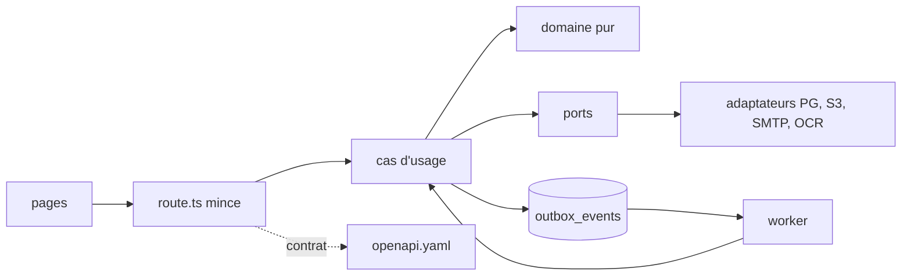

# Expense.io : consolider sans rupture

- **Auteur :** équipe 2Morgan (Antoine Blumenroeder, relu par le PO)
- **Statut :** document de conception, sans valeur de décision (seules les ADR acceptées font foi, `docs/adr/README.md`)
- **Date :** 28/10/2026, mis à jour le 29/10/2026 sur `main` au commit `875d7d8`

---

## Vue d'ensemble

Expense.io est un SaaS B2B de notes de frais, où un tenant est une entreprise. Huit ADR, toutes acceptées, décrivent la cible atteinte sur `main` :

| ADR | Décision |
|---|---|
| ADR-001 | Isolation par entreprise : RLS PostgreSQL, rôles restreints, inscription par invitation |
| ADR-002 | Monolithe modulaire hexagonal |
| ADR-003 | Outbox transactionnelle et worker pour l'asynchrone |
| ADR-004 | Contrat d'API d'abord (OpenAPI), erreurs RFC 9457 |
| ADR-005 | Harnais de validation : tests, CI, garde-fous |
| ADR-006 | Migration du code legacy : Strangler Fig et Branch by Abstraction |
| ADR-007 | Observabilité OpenTelemetry et Grafana, optionnelle |
| ADR-008 | Mesure d'usage avec Umami, optionnelle (heatmap et replays sans texte depuis l'amendement du 29/10) |

L'écart signalé le 28/10 avait été mesuré sur une branche en retard et ne s'applique plus. Sur `main` :

- `LEGACY_DB_ACCESS`, `LEGACY_GET_POOL`, `LEGACY_SQL_INTERPOLATION` (`eslint.config.mjs`) et `LEGACY_EDGES` (`scripts/architecture/layers.ts`) sont vides ;
- `openapi.yaml` décrit 17 opérations ;
- 11 migrations couvrent 7 tables : `companies`, `users`, `expense_notes`, `invitations`, `outbox_events`, `receipt_analyses`, `login_attempts` ;
- toutes les routes passent par un cas d'usage (ADR-006), avec un contrat identique et les E2E verts.

Ce document fige donc la cible atteinte et décrit la fin de la consolidation dans le même dépôt. La suite E2E sert d'oracle : aucune régression, aucune rupture du contrat HTTP.

## Le problème

Corriger directement dans le code d'origine ramenait toujours les mêmes défauts : un `WHERE` oublié laisse voir une entreprise depuis une autre, une seconde connexion casse l'atomicité de la soumission, un changement de forme d'erreur casse le front et les E2E rejoués par les correcteurs. Repartir d'un dépôt vide ferait perdre l'historique des migrations, les liens vers les ADR, la CI et les identifiants E2E qui portent le contrat. L'ADR-006 écarte donc le Big Bang.

Il reste à consolider, pas à reconstruire :

- garder identique le comportement HTTP observé par les E2E ;
- garder vides les quatre listes `LEGACY_*` ;
- fermer les derniers écarts : date de retrait du champ `error` déprécié, comptage des événements `dead` sans index, bascule vers un second adaptateur seulement quand il existe.

## Objectifs

1. **Non-régression.** Tous les scénarios Playwright qui passent aujourd'hui passent encore sans modification : mêmes codes, mêmes parcours, mêmes champs JSON. Un champ de réponse nouveau a son propre test (ADR-005 §2) ; ajouter une valeur à une énumération n'est pas automatiquement compatible (ADR-004 §7.1). Les erreurs restent en `application/problem+json`, avec `code` et `requestId` stables, et gardent le champ `error` déprécié avec son texte historique. Modifier un test E2E existant demande une ADR acceptée et le label `changement-e2e` sur la PR ; le hook `guard-frozen.mjs` et la CI le font respecter.
2. **Isolation.** La RLS sous `expense_app` (web) et `expense_worker` (worker) porte la frontière entre entreprises ; le `WHERE company_id` écrit dans les requêtes reste en défense en profondeur. ISO-01 à ISO-11 restent verts, fixtures créées sous le rôle propriétaire via `E2E_DATABASE_URL`.
3. **Soumission atomique et rejouable.** Reçu stocké sur S3 d'abord, puis une seule transaction SQL pour la note et l'événement d'outbox ; dédoublonnage par `Idempotency-Key` ; aucune ligne avec `receipt_key = ''`.
4. **Un seul mécanisme asynchrone.** Table `outbox_events` et worker, relances bornées, état `dead`, un événement par destinataire.
5. **Contrat explicite et vérifié.** `openapi.yaml` décrit les 17 opérations ; la CI échoue sur une dérive (`npm run check:api`) ou une rupture (`make api-breaking`, oasdiff).
6. **Schéma additif et réversible.** La migration initiale ne bouge pas ; chaque changement est une nouvelle migration horodatée avec son `down`. Les rôles restreints restent vérifiés par la suite à chaque PR (ISO-07, ISO-10, ISO-11).

## Hors périmètre

1. **Aucune fonctionnalité produit nouvelle.** Pas de facturation au-delà d'un futur `BillingPort` alimenté par `expense_note.decided` (notes approuvées seulement). Ni multi-devise, ni centre de notifications dans l'application.
2. **Ni micro-services, ni broker, ni nouvelle base.** Un déploiement Next.js, PostgreSQL, S3 et le worker.
3. **Ni version dans l'URL (`/v1`), ni pagination.** Les listes restent complètes ; une pagination par curseur se rouvre par ADR au-delà de quelques centaines d'éléments par entreprise ou d'une charge mesurable. Le champ `error` déprécié reste jusqu'à son retrait annoncé.
4. **Pas de réplication multi-région.** Une instance (application et base) par région suffit, dans l'hypothèse d'une entreprise rattachée à une seule région. Une validation entre régions rouvrirait la conception.

## Questions ouvertes

1. **Champ `error` déprécié** : quand le retirer, et quels consommateurs le lisent encore ?
2. **Événements `dead` sans index** : la dette locale de l'ADR-007 reste. Un retard soutenu de l'outbox au-delà d'une minute fait reconsidérer un broker (ADR-003), pas l'index. Quel volume justifierait l'index avant cela ?
3. **Premier second adaptateur** : pas de bascule tant qu'un second adaptateur n'arrive pas dans la même PR (ADR-006, décision 2). Premier candidat à trancher : OCR par une IA externe, ou facturation sur `expense_note.decided`.

## Architecture technique

Les route handlers restent minces : authentifier, valider l'entrée contre le contrat, appeler un cas d'usage, formater la réponse. Les cas d'usage orchestrent le domaine pur et les ports. Les adaptateurs implémentent les ports pour PostgreSQL, S3, SMTP et Tesseract. `src/composition/` branche les ports sur les adaptateurs ; il ne gagne un sélecteur par variable d'environnement qu'avec un second adaptateur, dans la même PR. Le worker consomme `outbox_events` par les handlers déclarés (`buildHandlers()`, `src/worker/handlers.ts`) ; un traitement long comme l'OCR travaille hors de la transaction de l'événement, puis valide court (amendement de l'ADR-003).

Tenir la ligne :

- les listes `LEGACY_*` restent vides ; `eslint.config.test.ts` et `scripts/architecture/architecture.test.ts` échouent sur une violation nouvelle ou une exception devenue inutile ;
- `openapi.yaml` reste la source de vérité, avec `src/types/api.d.ts` et `src/generated/api-contract.json` générés, et oasdiff en CI ;
- les migrations restent additives, avec `down` ;
- la télémétrie reste dans `src/lib/telemetry/`, `src/worker/telemetry.ts` et `src/instrumentation.ts`, désactivée sans `OTEL_EXPORTER_OTLP_ENDPOINT` ou avec `OTEL_SDK_DISABLED=true`, sans route nouvelle ni identifiant d'entreprise dans les étiquettes ;
- la mesure d'usage reste désactivée sans `UMAMI_SCRIPT_URL` et `UMAMI_WEBSITE_ID`, et la heatmap sans `UMAMI_HEATMAP=true`.

## Options écartées

### A. Repartir d'un dépôt vide

- **Pour :** aucune liste legacy à tenir, organisation des fichiers libre.
- **Contre :** perd l'historique des migrations, les liens vers les ADR, la CI et les identifiants E2E qui portent le contrat ; les correcteurs rejouent les E2E contre un comportement que le nouveau dépôt devrait réapprendre ; les reprises de données et les correctifs de cas limites se perdent.
- **Pourquoi écartée :** l'ADR-006 écarte le Big Bang pour ce risque. La migration progressive sur place a déjà vidé les listes legacy avec un contrat identique.

### B. Un micro-service par domaine

- **Pour :** passage à l'échelle indépendant, frontières fortes.
- **Contre :** des transactions locales deviennent des sagas distribuées pour 7 tables et 17 opérations ; l'authentification, l'isolation, la CI et l'observabilité se multiplient.
- **Pourquoi écartée :** option C de l'ADR-002. Ni la charge ni l'équipe ne le justifient ; un déploiement par région couvre déjà l'international.

### C. Un broker dès maintenant

- **Pour :** plafond de débit plus haut que le polling PostgreSQL.
- **Contre :** une infrastructure et un mode de panne de plus pour un volume que PostgreSQL absorbe ; le retard de l'outbox reste proche de zéro.
- **Pourquoi écartée :** l'ADR-003 garde le broker derrière le même port `EventOutbox` ; on bascule sur un retard soutenu de plus d'une minute.

### D. Acheter l'identité (Keycloak, Auth0)

- **Pour :** MFA, SSO et protection contre la force brute inclus.
- **Contre :** change les parcours de connexion et d'inscription décrits par les E2E, ajoute un coût d'hébergement ou par utilisateur et des questions de localisation des données ; ne corrige pas S5 ni S9 à lui seul.
- **Pourquoi écartée :** l'ADR-001 garde Auth.js avec le secret en variable d'environnement, le rôle relu en base, une session de 8 h et une limite de tentatives en table. À rouvrir sur une demande de SSO ou de MFA.

### E. Isolation physique par entreprise

- **Pour :** isolation la plus forte, un schéma ou une base par entreprise.
- **Contre :** refonte lourde, N schémas ou bases à migrer, sauvegarder et surveiller, création à chaque inscription ; aucun gain sur RLS et `WHERE` à l'échelle actuelle.
- **Pourquoi écartée :** options C et D de l'ADR-001. À rouvrir si un contrat client impose l'isolation physique ou la localisation des données.

## Plan de mise en œuvre

Une seule liste, sans code de production : le périmètre de chaque fichier et sa raison.

1. **`openapi.yaml`** (à modifier, avec le code) : garder les 17 opérations alignées sur les handlers et sur `src/types/api.d.ts` et `src/generated/api-contract.json`. Pas de date de retrait du champ `error` ici : le retrait demande d'abord sa propre ADR, la liste des consommateurs et une annotation `Sunset`.
2. **`src/http/problem.ts` et `src/http/contractResponses.ts`** (à garder) : construire `application/problem+json` avec `type`, `title`, `status`, `detail`, `code` et `requestId`, et émettre le texte historique de `error` jusqu'à son retrait. Aucune enveloppe d'erreur propre à une route.
3. **`src/components/apiError.ts`** (reporté à la version du retrait) : traduire `code` et les codes de champ en français, avec un texte générique par défaut. Ne cesser de lire `error` qu'à la version du retrait, avec le texte attendu de MGR-05 mis à jour à ce moment-là, par ADR.
4. **`src/ports/OcrPort.ts` et `src/composition/ocr.ts`** (reporté au second adaptateur) : ajouter l'adaptateur d'IA externe derrière le même port, choisi par variable d'environnement dans `src/composition/ocr.ts`, Tesseract par défaut. Retirer l'ancien adaptateur seulement après la bascule, dans la même livraison.
5. **`src/ports/BillingPort.ts`** (reporté à la facturation) : interface à concevoir (méthodes, charge utile, abonnement du handler, erreurs), alimentée par `expense_note.decided` sur les notes approuvées. Ni route ni domaine à modifier à l'arrivée du premier adaptateur.
6. **`migrations/<horodatage>_<nom>.sql`** (à créer par changement) : changement additif avec son `down`, jamais d'édition de la migration initiale. Pas d'index sur les événements `dead` dans cette livraison.
7. **`docs/architecture/` et `docs/index.html`** (avec le code) : `npm run generate:architecture` dans la même PR que tout changement de couche, de route ou de composition, pour que `npm run check` reste vert.

## Vérifications

- **Build :** `npm run build`.
- **Tests unitaires :** `npm run test:unit`, Vitest à côté du code modifié.
- **Analyse statique :** `npm run check` (lint, types, couches, listes legacy vides, `LEGACY_EDGES` compris, doc générée à jour).
- **Couverture :** pas de seuil bloquant (ADR-005).
- **E2E :** `npx playwright test -g "<ID>"` pour les familles touchées, puis `make test-e2e` ; `make verify` pour refaire la CI. La rupture de contrat (`make api-breaking`) reste bloquante.
